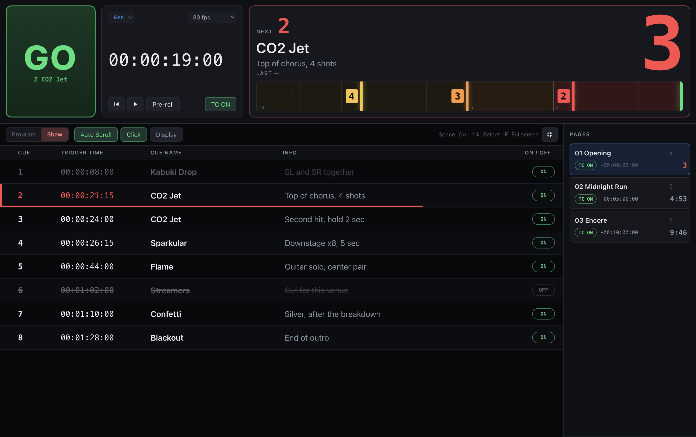
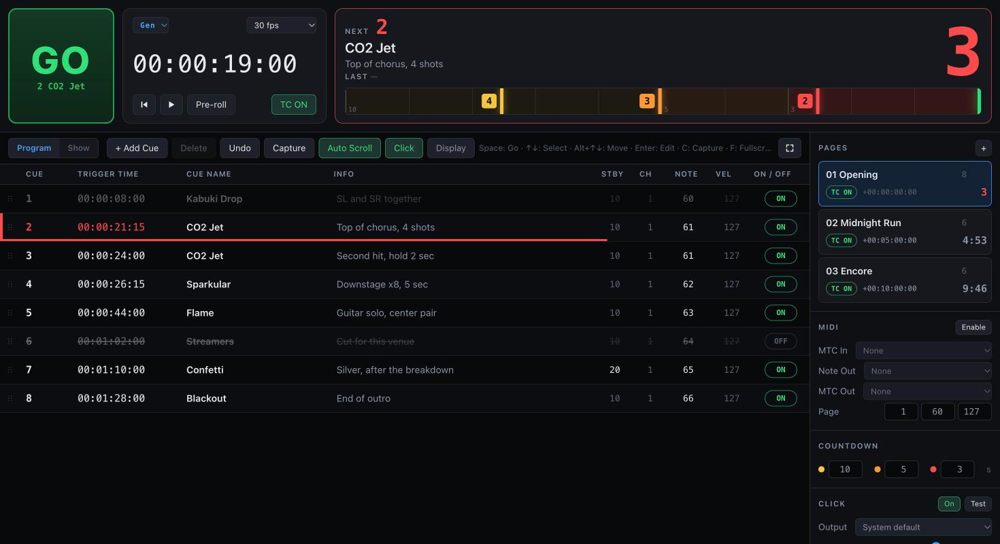
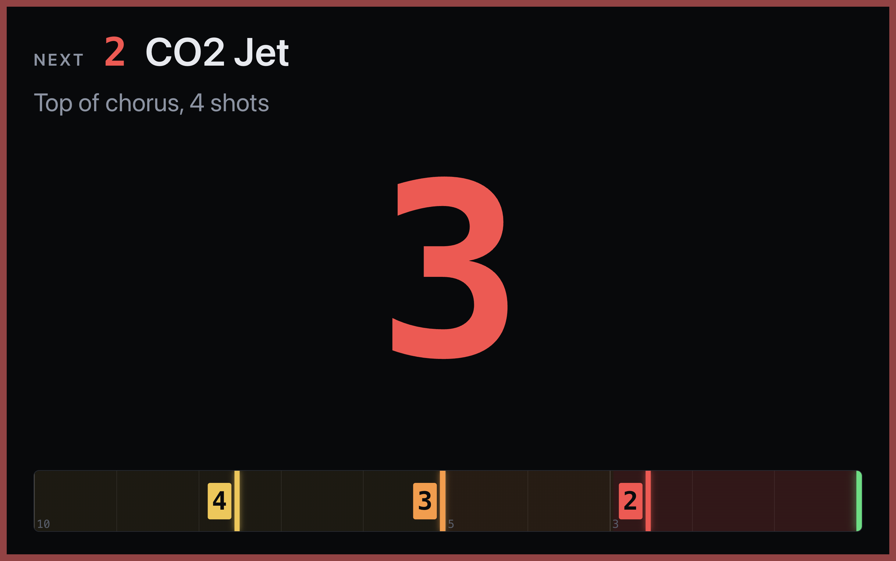

# TC-CD (Timecode Countdown)

[English](README.md) | 日本語

TC-CD は、タイムコードに追従して各 Cue までの残り時間を数え、GO を押すタイミングを見せる Web アプリです。タイムコードを受けられない機材でも、手動で時間通りに操作できるようにするためのものです。

PC のブラウザで動きます。インストールは不要で、一度開いておけば回線のない現場でも使えます。

**アプリを開く: https://hugesesame.github.io/timecode-countdown/** （PC の Chrome か Edge）

> **ベータ版です。** TC-CD はまだ検証中で、実際の本番では使っていません。MTC、LTC、MIDI の出力は、いくつかのソフトウェアの送り元でしか確認していません。本番で使う前に、実際の機材で試してください。



## できること

- **カウントダウン**: 次の Cue までの残り時間を表示します。GO が近づくと黄 → オレンジ → 赤に変わり、GO の瞬間に緑で点滅します。
- **レーン**: カウントダウンの下にあるバーです。Cue のマーカーが GO ラインへ一定の速さで流れるので、続けて来る Cue も見えます。
- **Cue List**: ページで管理できます。Cue ごとに番号、Trigger Time、名前、Info を持ちます。ページは前面になくても動作します。
- **タイムコードの入力元**
  - Gen: 内蔵ジェネレーター。仕込みやリハーサル用
  - MTC: MIDI 入力で受ける MIDI タイムコード
  - LTC: 音声入力から読み取るタイムコード
- **MIDI Note の出力**: Cue の実行時に送ります。チャンネル、ノート、ベロシティを Cue ごとに設定できます。
- **クリック音**: Cue の 3、2、1 秒前にクリックが鳴り、GO の瞬間に高い音が鳴ります。
- **表示ウィンドウ**: セカンドスクリーン用です。次の Cue、カウントダウン、レーンだけを大きく出します。
- **Program / Show モード**: Show モードでは表示が大きくなり、編集がロックされます。
- **ショーファイル**: 作業中の内容はブラウザに自動で保存されます。JSON ファイルへの書き出しと読み込みもできます。

フレームレートは 24、25、29.97 ドロップフレーム、30 fps に対応しています。

## 必要なもの

- **Chrome か Edge** が入った PC。Web MIDI API を使うためです。クリック音の出力先を選ぶ機能も、この 2 つのブラウザが必要です。
- 画面は PC 用です。スマートフォンやタブレットには対応していません。

## 始め方

1. PC の Chrome か Edge で **https://hugesesame.github.io/timecode-countdown/** を開きます。
2. これだけで使えます。インストールもアカウントの登録も不要です。

次からすぐ開けるように、ブックマークに入れておくと便利です。

### ブラウザに聞かれること

一部の機能は、初めて使う時にブラウザが許可を求めます。その都度 **許可** を選んでください。間違えてブロックを選んだ時は、アドレスバーの左端のアイコンをクリックすると設定を変えられます。

| いつ | ブラウザが聞くこと | 理由 |
|---|---|---|
| MIDI の **Enable** を押した時 | MIDI デバイスの制御 | MTC を受け、MIDI Note を送るため |
| 入力元に **LTC** を選んだ時 | マイクの使用 | 音声入力からタイムコードを読むため。録音はしません |
| **Display** を押した時 | ポップアップの許可（ウィンドウがブロックされた時だけ） | 表示ウィンドウを開くため |

クリック音には、もう 1 つ手順があります。ブラウザは、ページのどこかをクリックするまで音を出させません。Click ボタンが **⚠ Click** になっている時は、そのボタンか、ページのどこかをクリックしてください。

### ショーの保存場所

- ショーは、作業中にその PC のブラウザへ自動で保存されます。保存ボタンはありません。
- どこにも送信されません。別の PC や、同じ PC の別のブラウザには入っていません。
- ブラウザのサイトデータを消去すると、ショーも消えます。
- **Export** を押すと、ショーをファイルに保存できます。バックアップを取る時と、別の PC へ **Import** で移す時に使います。

### 回線がない時

- 一度開けば、回線が切れてもそのまま動き続けます。タイムコード、MIDI、クリック音、表示ウィンドウは、インターネットを使いません。
- アプリは、自分自身の控えもブラウザに保存します。右パネルの一番下（Program モード）に **Offline ready** と出ていれば、その PC では回線がなくても、再読み込みや開き直しができます。
- 回線のない現場へ持っていく PC は、回線のある場所で一度開き、**Offline ready** の表示を確かめておいてください。
- 回線がある時は、開くたびに最新の版を読み込みます。

### サンプルデータで試す

[`samples/demo-show.json`](samples/demo-show.json) はサンプルのショーです。架空のコンサートの特効 Cue が、3 ページ・20 Cue 入っています。リンクを開き、ファイルの右上にあるダウンロードボタンで PC に保存してください。

1. **Import** を押して、保存した `demo-show.json` を選びます。今のショーは置き換わるので、必要なら先に Export してください。
2. タイムコードの入力元を **Gen** にします。
3. 再生ボタンを押します。または、タイムコード表示をクリックして `00001900` と打ち、Enter を押すと `00:00:19:00` に頭出しできます。Cue が 3 つ続けて来る場面です。

## 使い方



1. **+ Add Cue** で Cue を足し、Trigger Time を入力します。`1000` と打つと `00:00:10:00` になります。
2. 左上でタイムコードの入力元を選びます（**Gen** / **MTC** / **LTC**）。
3. MTC や MIDI Note の出力を使う時は、MIDI の **Enable** を押してポートを選びます。
4. LTC を使う時は、マイクの使用を許可して、音声入力とチャンネルを選びます。録音はしません。
5. 本番では **Show** モードに切り替えます。

タイムコードが Trigger Time を越えると、Cue が実行されます。GO ボタンかスペースキーで手動でも実行できます。選択中の Cue を実行し、選択がなければ次に来る Cue を実行します。

タイムコードが先に飛んだ時、飛び越えた Cue は実行しません。戻った時は、その位置より後の Cue が再び有効になります。

### カウントダウン

- カウントダウンの数字をクリックすると、整数の表示と小数（10 分の 1 秒）の表示が切り替わります。整数は端数を切り上げるので、数字が 0 になった瞬間が GO です。表示ウィンドウも同じ設定に従います。
- 色が変わる秒数は、右パネルの **COUNTDOWN** で設定します。Standby（黄）、Warn（オレンジ）、Final（赤）の 3 つです。レーンの端から端までが Standby の秒数にあたります。
- **Stby** の列で、その Cue だけ Standby の秒数を変えられます。

### キー操作

| キー | 動作 |
|---|---|
| Space | GO |
| ↑ / ↓ | Cue を選択 |
| Alt + ↑ / ↓ | 選択中の Cue を移動 |
| Enter | 選択中の Cue を編集（Tab で隣の項目へ） |
| C | 現在のタイムコードを選択中の Cue に取り込む |
| F | フルスクリーン |
| ⌘Z / Ctrl+Z | Undo |
| Esc | 選択を解除 |

### ページ

- ページごとに Cue List と、タイムコードのオフセット（曲の頭の時刻など）を持ちます。
- ページの **TC ON / TC OFF** で、そのページの Cue をタイムコードで実行しないようにできます。
- ヘッダーの **TC ON** は、全ページに同じことをします。タイムコードの表示は動き続けます。

### 表示ウィンドウ

ツールバーの **Display** を押すともう 1 つウィンドウが開くので、セカンドスクリーンへ移動します。右上のボタン、F キー、ダブルクリックのどれかでフルスクリーンになります。メインの画面で開いているページに追従し、メインの画面を閉じると一緒に閉じます。



## 開発

アプリを改造したい人や、自分でビルドしたい人向けの説明です。使うだけなら不要です。Node.js が必要です。

```
npm install
npm run dev
```

ターミナルに表示されたアドレス（通常は http://localhost:5173/）を開きます。

| コマンド | 内容 |
|---|---|
| `npm run dev` | 開発サーバーを起動 |
| `npm test` | テストを実行 |
| `npm run build` | 型チェックをして `dist/index.html` をビルド |

`npm run build` は、アプリ全体を `dist/index.html` の 1 ファイルにまとめます。このファイルを PC にコピーして Chrome か Edge で開けば、サーバーなしで動きます。

3 つの開き方は、動作が少し違います。

| | 公開版 | 開発サーバー（localhost） | `dist/index.html` を直接開く |
|---|---|---|---|
| 必要なもの | ブラウザ | Node.js | ブラウザとファイル |
| インターネット | 最初の 1 回だけ必要 | 不要 | 不要 |
| 音声機器の選択（LTC の入力、クリック音の出力） | 選べる | 選べる | System default のみ |
| 保存されるショー | 公開版用に保存 | localhost 用に保存 | どちらとも別に保存 |

ショーの保存場所は、それぞれ別です。ショーを移す時は Export と Import を使います。

| 場所 | 中身 |
|---|---|
| `src/core/` | タイムコード計算、Cue の実行判定、MTC と LTC の読み取り、そのテスト |
| `src/io/` | Web MIDI、LTC の音声入力、クリック音 |
| `src/ui/` | ヘッダー、Cue List、右パネル、表示ウィンドウ |
| `src/app.ts` | アプリ全体の状態と操作 |

TypeScript、Vite、Vitest で作っています。実行時に必要な外部ライブラリはありません。

## ライセンス

[MIT](LICENSE) です。仕事の現場を含め、自由に使用、改造、再配布ができます。動作の保証はありません。
